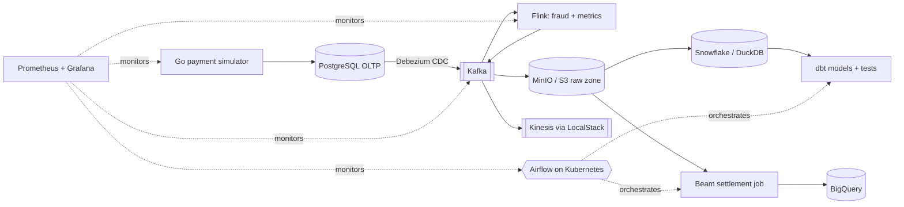

# PayFlow: End-to-End Payments Data Platform

A portfolio project that simulates a payment service provider (PSP) and builds the full data platform around it:
OLTP in PostgreSQL, CDC into Kafka, real-time fraud detection with Flink, a lakehouse and warehouse modelled with dbt,
batch reconciliation with Apache Beam, orchestration with Airflow on Kubernetes, infrastructure as code with Terraform,
CI/CD with GitHub Actions, and monitoring with Prometheus and Grafana.

> Status: **Phase 1 - OLTP + payment simulator** (see [docs/PROGRESS.md](docs/PROGRESS.md))

## Architecture (target)



## Quick start (Phase 1)

```bash
cp .env.example .env        # then edit the passwords
make sim-tidy               # download Go dependencies (first time)
make up                     # start postgres + simulator
make ps                     # both services should be "healthy"/"running"
make logs                   # watch the simulator's JSON logs
make validate               # run the data checks
make sim-metrics            # live counters from the simulator
```

## Repository layout

| Path | What lives there |
|---|---|
| `services/simulator/` | Go service that generates payment traffic |
| `infra/postgres/init/` | Schema and roles, applied on first database start |
| `infra/postgres/queries/` | Validation and analysis SQL |
| `docs/PROGRESS.md` | What is done and what is next |
| `docs/adr/` | Architecture Decision Records: why each choice was made |

## Make targets

Run `make help` for the full list.
